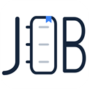
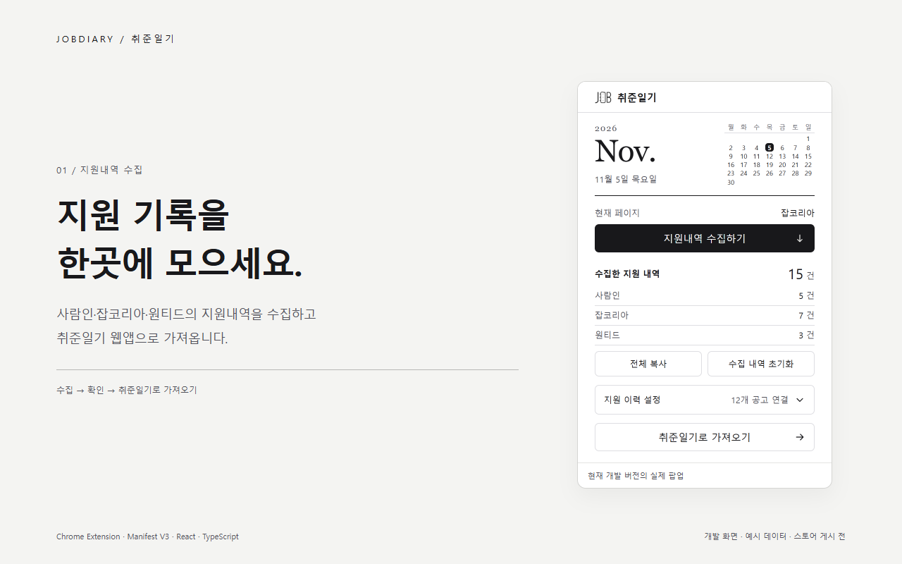
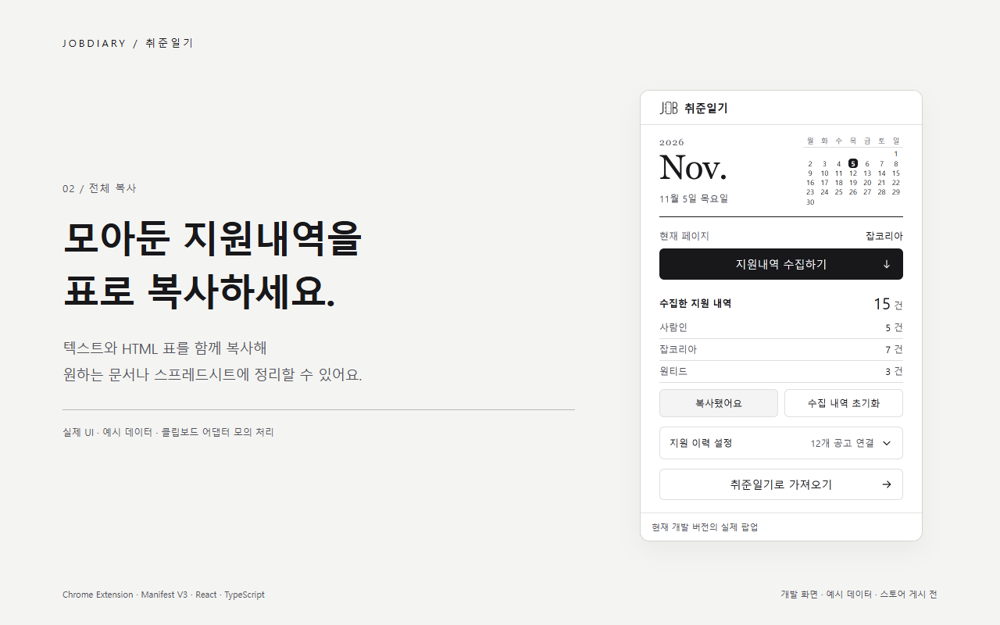
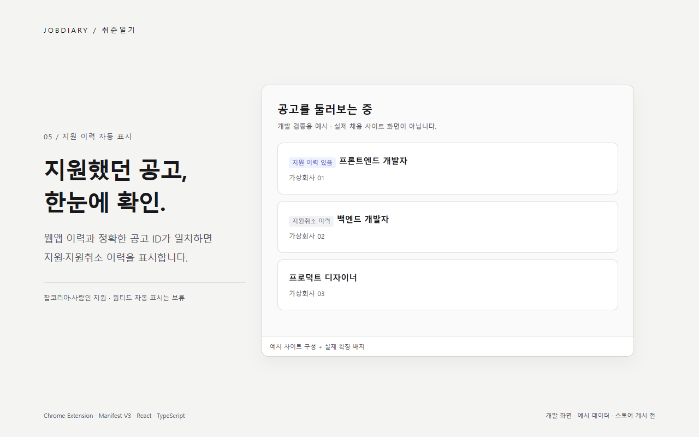
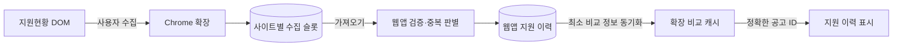

<div align="center">



# 취준일기 · JobDiary

**흩어진 지원 기록을 한곳에 모으고, 다음 단계를 준비합니다.**

채용 사이트의 지원내역을 수집하는 Chrome 확장과 지원 현황을 관리하는 웹앱을 함께 개발합니다.

[웹앱](https://jobdiary.vercel.app) · [Chrome 웹스토어](https://chromewebstore.google.com/detail/afnboeihbppogfinbickjaaadcgjkmil) · [익스텐션 안내](apps/extension/README.md) · [설계·검증 기록](docs/README.md)

[](https://github.com/YouVin/jobdiary/actions/workflows/ci.yml)



</div>

> 이 README와 이미지는 **dev 구현 기준**입니다. 현재 운영 웹앱·웹스토어 버전과 차이가 있으며, 최근 팝업·지원 이력 표시의 운영 반영은 별도 출시 단계입니다. 이미지에는 예시 데이터만 사용했습니다.

## 어떤 문제를 해결하나요?

지원 기록이 사람인·잡코리아·원티드에 흩어져 있으면 전체 진행 상황을 확인하거나 같은 내용을 다시 입력하기 번거롭습니다. 취준일기는 사용자가 로그인해 보는 지원현황에서 내역을 수집하고, 웹앱에서 단계별로 관리하도록 연결합니다.

웹앱에 저장한 이력은 공고를 둘러볼 때도 활용합니다. 잡코리아·사람인에서 정확히 같은 공고 ID가 확인되면 지원 또는 지원취소 이력을 표시합니다. 회사 이름이나 제목만으로 지원 사실을 추정하지 않습니다.

## 주요 기능

| 영역 | 현재 구현 |
| --- | --- |
| 수집 | 사람인·잡코리아·원티드 지원현황에서 회사·공고·지원일·상태 수집 |
| 저장·전달 | 사이트별 수집 슬롯, 표 전체 복사, 웹앱으로 가져오기 |
| 웹앱 | 칸반 보드, 지원 추가·수정·삭제, 단계·면접일·마감일 관리 |
| 이력 표시 | 웹앱 이력 기반 비교 캐시, 잡코리아·사람인의 정확한 공고 ID 일치 표시 |
| 팝업 | 흑백 일기장 UI, 오늘 날짜·작은 달력, 명확한 보조 버튼·접기 가능한 설정 |
| 마감일 | 출처에서 확인할 수 있는 명시 날짜만 선택적으로 보충하고, 확인되지 않으면 비워 둠 |

원티드 자동 표시와 모든 사이트의 모든 화면 지원은 포함하지 않습니다. 웹앱의 일기 작성·통계 UI는 후속 계획입니다. 상세 범위는 [지원 이력 표시](docs/APPLICATION_HISTORY_BADGES.md), [마감일 검증](docs/DEADLINE_VALIDATION.md), [웹앱 로드맵](docs/ROADMAP.md)에 기록했습니다.

## 사용 흐름

1. 채용 사이트에 로그인하고 **지원현황 페이지**를 엽니다.
2. 취준일기 확장에서 **지원내역 수집하기**를 누릅니다. 다른 사이트에서도 반복할 수 있습니다.
3. **취준일기로 가져오기**를 눌러 웹앱에서 내역을 확인하고 관리합니다.
4. 웹앱 이력이 연결되면 지원하는 사이트의 일치 공고에 이력이 표시됩니다. 팝업의 **지원 이력 설정**에서 자동 표시를 켜거나 끌 수 있습니다.

**전체 복사**는 표 데이터를 클립보드에 넣고, **수집 내역 초기화**는 확장에 모아둔 수집 슬롯만 비웁니다. 웹앱 저장 내역과 비교 캐시는 별개입니다.

## 화면

| 표로 복사 | 지원 이력 확인 |
| --- | --- |
|  |  |

이미지의 팝업은 실제 개발 확장 화면입니다. 사이트 영역은 설명용 예시이며 실제 로그인 화면이 아닙니다. [전체 이미지·재제작 방법](apps/extension/scripts/store-screenshots/README.md)을 제공합니다.

## 모노레포 구조

<pre>
jobdiary/
├── apps/web/          Next.js 웹앱
├── apps/extension/    Vite·CRXJS Chrome 확장
├── packages/shared/   공통 메시지·공고 ID·비교 캐시 계약
├── docs/              설계·의사결정·검증·포트폴리오 기록
├── supabase/          기존 마이그레이션과 Edge Functions
└── package-lock.json  루트에서 관리하는 단일 잠금 파일
</pre>

별도 저장소로 개발하던 웹앱과 확장을 npm workspaces로 통합했습니다. 연동 계약을 한 PR에서 검토하면서 앱별 실행·빌드·버전·출시 경계는 유지합니다. Git 이력과 대표 웹앱 주소를 보존한 과정은 [모노레포 전환 사례](docs/MONOREPO_CASE_STUDY.md)에 남겼습니다.

## 데이터 흐름과 책임



- 확장은 수집·변환·로컬 저장·복사·전달을 담당합니다. 수집 결과는 content script가 직접 저장합니다.
- 웹앱은 가져오기 검증·중복 판별·최종 지원 이력을 담당합니다.
- 비교 캐시는 공고 ID와 지원/취소 상태 등 최소 정보로 구성하며 계정·origin 경계를 지킵니다. 수집 슬롯과 따로 관리합니다.
- 로그인 정보·비밀번호를 입력받지 않습니다. 마감일 보충을 위한 추가 요청과 읽는 데이터의 상세 범위는 [확장 개인정보 문서](apps/extension/docs/PRIVACY_POLICY.md)를 따릅니다.

## 기술 스택

| 웹앱 | 익스텐션 | 공통·검증 |
| --- | --- | --- |
| Next.js · React · TypeScript | Manifest V3 · CRXJS · Vite | npm workspaces · TypeScript 공통 패키지 |
| Tailwind CSS · Zustand · dnd-kit | React · Tailwind CSS · chrome.storage | Node test runner · Vitest · Chromium 표본 검증 |
| Supabase · Vercel | 사이트별 DOM 파서·수명주기 관리 | GitHub Actions의 앱별 테스트·빌드 |

정확한 버전은 각 앱의 package.json과 루트 package-lock.json을 기준으로 합니다.

## 로컬 실행

Node.js **22.12 이상 25 미만**, npm **11 이상**을 사용합니다. 설치는 저장소 루트에서 한 번 실행합니다.

```bash
git clone https://github.com/YouVin/jobdiary.git
cd jobdiary
npm ci

# apps/web/.env.example을 참고해 apps/web/.env.local 준비
npm run dev:web          # http://localhost:3000
npm run dev:extension    # 별도 터미널에서 실행
```

Chrome의 chrome://extensions에서 개발자 모드를 켜고 **apps/extension/dist**를 압축해제 확장으로 로드합니다. 개발 서버를 계속 실행해 두세요. content script가 바뀌면 확장과 해당 사이트 탭을 함께 새로고침합니다.

```bash
npm run lint
npm test
npm run build

# 앱별 실행도 가능
npm run test:web
npm run test:extension
npm run build:web
npm run build:extension
```

웹앱 결과는 apps/web/.next, 확장 결과는 apps/extension/dist·release입니다. 개발 서버가 사용 중인 확장 dist를 보존해야 할 때는 [별도 출력 검증 방법](apps/extension/scripts/store-screenshots/README.md)을 참고하세요. 실제 환경 값·로그인 세션·개인 데이터는 커밋하지 않습니다.

## 설계와 검증 기록

| 주제 | 기록 |
| --- | --- |
| 두 저장소 통합·이력 보존·배포 경계 | [모노레포 전환 사례](docs/MONOREPO_CASE_STUDY.md) |
| 웹앱을 기준으로 비교 캐시를 동기화한 이유 | [지원 이력 동기화](docs/APPLICATION_HISTORY_SYNC.md) |
| 정확한 공고 식별·동적 DOM·탭 생명주기·성능 | [자동 표시 설계와 실제 검증](docs/APPLICATION_HISTORY_BADGES.md) |
| 사용자 피드백에서 흑백 일기장 UI까지 | [팝업 디자인·전후 비교·화면 높이](docs/EXTENSION_POPUP_DESIGN.md) |
| 마감일의 출처와 확인 가능한 범위 | [마감일 검증 기록](docs/DEADLINE_VALIDATION.md) |
| GitHub 소개·이미지의 재현과 출처 | [GitHub 공개 자료 갱신](docs/GITHUB_SHOWCASE.md) |

작업별 진입점은 [문서 인덱스](docs/README.md), 남은 출시 확인은 [단계별 계획](docs/IMPLEMENTATION_ROADMAP.md)을 참고하세요. 자동화는 예시 데이터와 독립 브라우저 프로필을 사용하며 실계정·실제 숨김 탭 등 미확인 범위를 구분해 기록합니다.

## 배포와 기여

main은 배포, dev는 통합 브랜치입니다. 작업은 feat/*, fix/*, chore/* 등 이슈별 브랜치와 dev 대상 PR로 관리합니다. 웹앱 배포와 Chrome 웹스토어 제출은 별도로 진행합니다.

- [웹앱 안내](apps/web/README.md)
- [익스텐션 사용법·지원 범위](apps/extension/README.md)
- [기여 시 개발 규칙](docs/WORKING_AGREEMENT.md)
- [이전 경로·외부 링크 체크리스트](docs/MONOREPO_HANDOFF.md)

기존 [jobdiary-extension 저장소](https://github.com/YouVin/jobdiary-extension)는 이전 이슈·릴리스 이력을 보존합니다. 현재 개발 위치는 이 모노레포의 apps/extension입니다.
