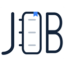
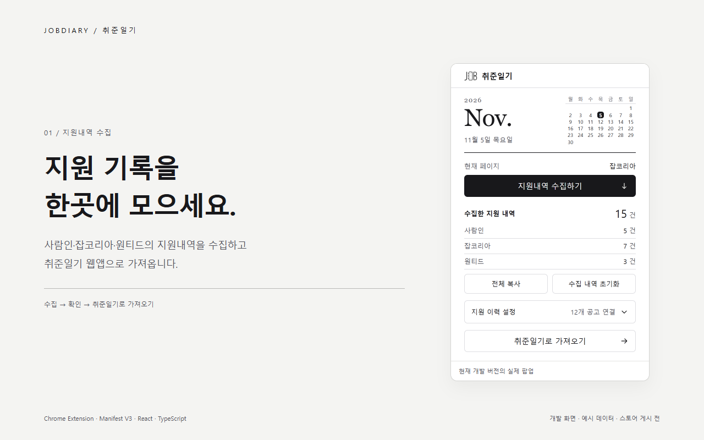
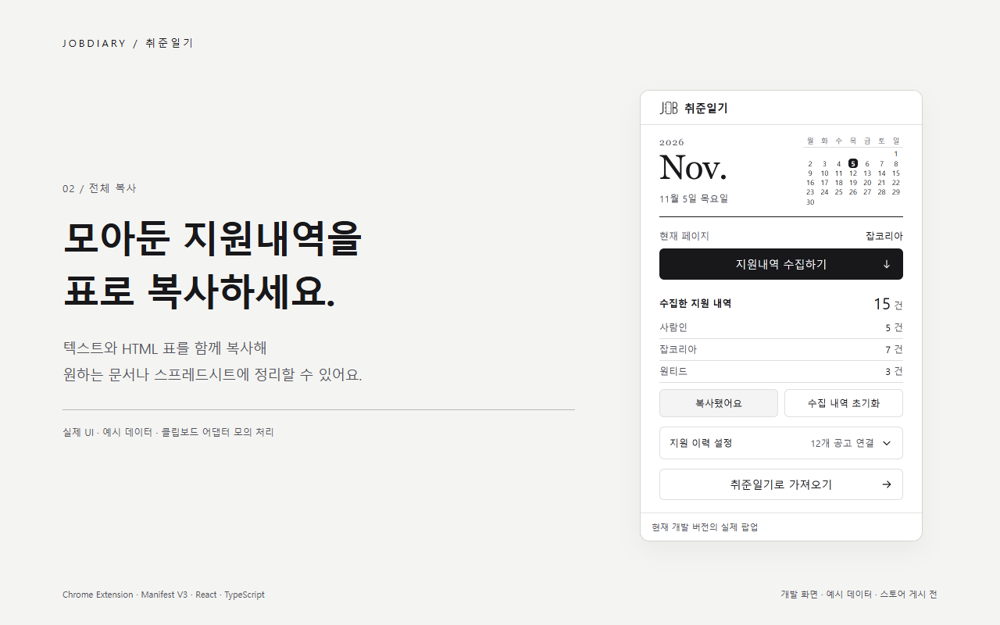
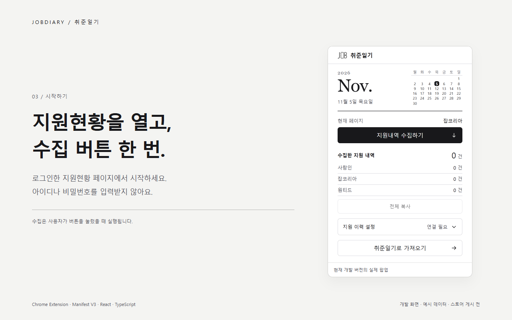
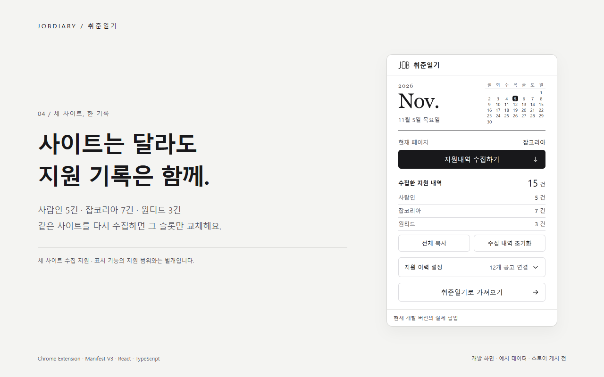
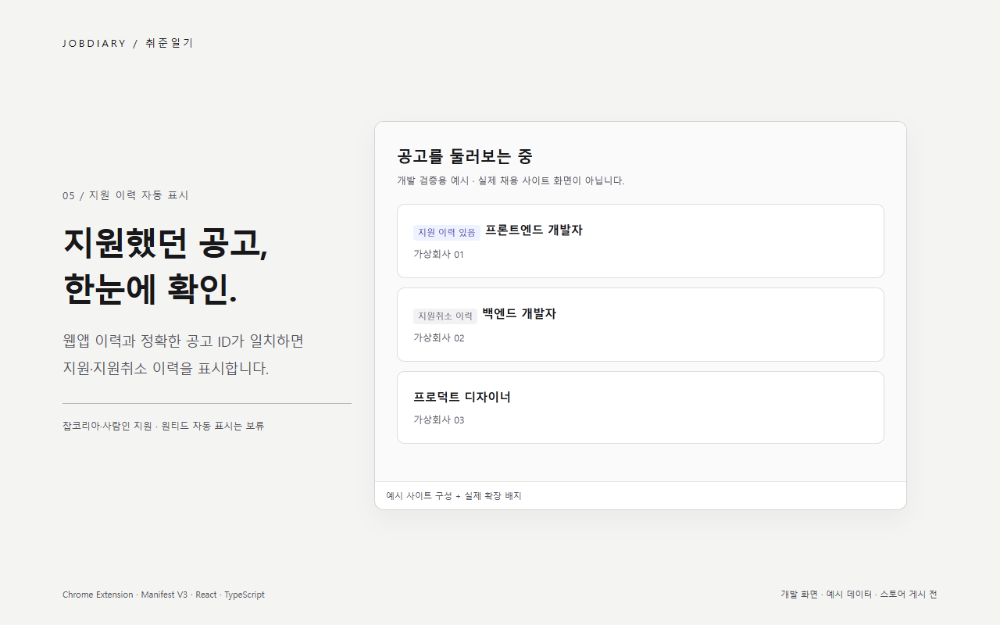
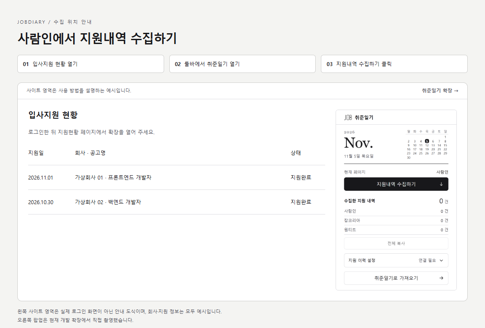
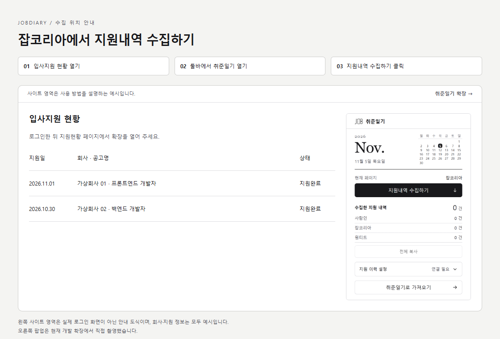
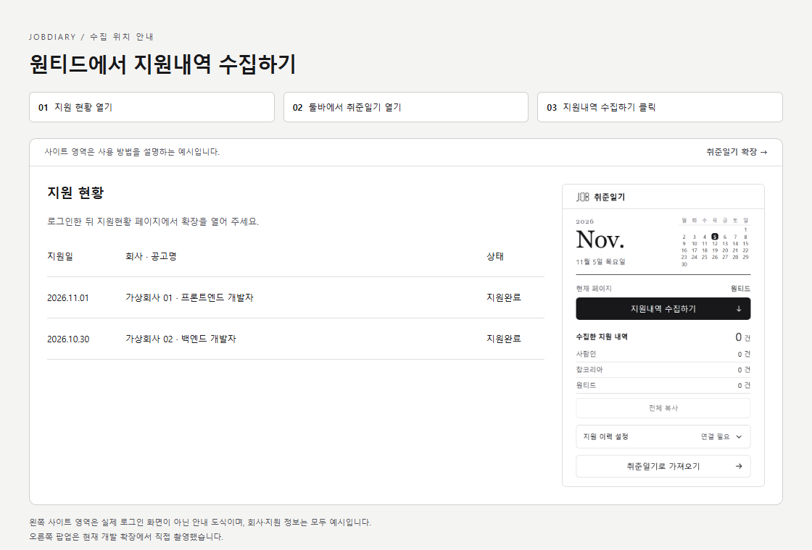

<div align="center">



# 취준일기 Chrome 익스텐션

**지원현황은 수집하고, 지원했던 공고는 다시 확인하세요.**

[Chrome 웹스토어](https://chromewebstore.google.com/detail/afnboeihbppogfinbickjaaadcgjkmil) · [웹앱](https://jobdiary.vercel.app) · [모노레포](../../README.md) · [설계 문서](docs/ARCHITECTURE.md)

[](https://github.com/YouVin/jobdiary/actions/workflows/ci.yml)



</div>

> 현재 **dev 구현과 예시 데이터**를 소개합니다. 흑백 팝업·마감일 보충·지원 이력 자동 표시의 웹스토어 반영은 별도 출시 단계입니다. 기존 스토어 항목을 최신 개발 버전과 동일하게 안내하지 않습니다.

## 할 수 있는 일

| 기능 | 동작 |
| --- | --- |
| 지원현황 수집 | 사람인·잡코리아·원티드에서 회사·공고·지원일·사이트 상태를 읽음 |
| 사이트별 저장 | 같은 사이트를 다시 수집하면 해당 슬롯을 최신 결과로 교체 |
| 전체 복사 | text/plain(TSV)과 text/html 표를 함께 복사, 미지원 환경은 텍스트로 폴백 |
| 웹앱 가져오기 | 취준일기를 열어 수집 내역을 가져오고 웹앱에서 중복 판별·저장 |
| 지원 이력 표시 | 웹앱 비교 캐시와 정확한 공고 ID가 일치하면 지원/취소 이력 표시 |
| 선택적 마감일 보충 | 출처에서 확인된 유효 날짜만 전달, 실패해도 지원내역 저장 유지 |

수집과 자동 표시는 지원 범위가 다릅니다.

| 사이트 | 지원현황 수집 | 공고의 지원 이력 표시 |
| --- | --- | --- |
| 사람인 | 지원 | 지원: 확인된 공고 URL·ID 기준 |
| 잡코리아 | 지원 | 지원: 확인된 공고 URL·ID 기준 |
| 원티드 | 지원 | 보류: 현재 수집 이력의 공고 식별 정보 부족 |

모든 페이지·iframe·Shadow DOM 지원을 보장하지 않습니다. 회사명·제목으로 추정하지 않으며, 일치하지 않거나 주소가 없는 공고에 ‘미지원’을 표시하지 않습니다. 마감이 지난 기록도 과거 지원 사실일 수 있으므로 비교에서 일괄 제외하지 않습니다.

## 스크린샷

| 표 전체 복사 | 수집 시작 |
| --- | --- |
|  |  |

| 세 사이트의 수집 내역 | 지원·취소 이력 표시 |
| --- | --- |
|  |  |

팝업은 실제 개발 확장에서 촬영했습니다. 사이트 구성과 회사명·지원 내역은 예시이며 사용자 계정을 사용하지 않았습니다. [원본·규격·재생성 절차](scripts/store-screenshots/README.md)를 함께 제공합니다.

## 사용 방법

1. 채용 사이트에 로그인한 뒤 지원현황 페이지를 엽니다.
2. 브라우저 툴바에서 취준일기를 열고 **지원내역 수집하기**를 누릅니다.
3. 필요한 다른 사이트에서도 수집합니다. 사이트별 건수와 수집 결과를 확인합니다.
4. **전체 복사**로 표를 복사하거나 **취준일기로 가져오기**로 웹앱에서 관리합니다.

<details>
<summary>사람인 · 입사지원 현황에서 수집</summary>



</details>

<details>
<summary>잡코리아 · 입사지원 현황에서 수집</summary>



</details>

<details>
<summary>원티드 · 지원 현황에서 수집</summary>



</details>

사이트 영역은 사용 방법을 설명하기 위한 도식이며 실제 로그인 화면이 아닙니다.

## 팝업의 버튼과 숫자

| 항목 | 의미 |
| --- | --- |
| 수집한 지원 내역 | 확장의 사이트별 수집 슬롯 합계 |
| 전체 복사 | 수집 슬롯의 표 데이터 복사. 저장값은 유지 |
| 수집 내역 초기화 | 한 번 더 눌러 확인한 뒤 수집 슬롯만 비움 |
| 지원 이력 설정 | 자동 표시·연결 상태·갱신/미확인 제외 정보를 펼쳐 확인 |
| 취준일기에서 연결 / 이력 갱신 | 웹앱을 열어 로그인·이력 동기화. 자동 가져오기 신호 없음 |
| 취준일기로 가져오기 | 웹앱에 수집 내역 가져오기 신호와 함께 진입 |

수집 건수와 ‘공고 연결’ 건수는 다른 데이터입니다. 비교 캐시는 웹앱 저장 이력에서 오며 수집 슬롯 초기화로 지워지지 않습니다. 팝업의 작은 달력은 기기의 오늘 날짜를 표시합니다.

## 구조와 데이터 흐름

<pre>
src/content/      사이트별 파서·변환/저장 진입·지원 이력 표시 엔진
src/background/   외부 웹앱 메시지 검증·비교 캐시·마감일 보충 요청
src/popup/        수집·표 복사·초기화·가져오기·표시 설정
src/lib/          상태/날짜 정규화·저장·클립보드·연동 헬퍼
src/types/        수집 데이터 타입
../../packages/shared/  공통 메시지·공고 식별·비교 캐시 검증
</pre>

수집 버튼 → 해당 탭의 content script → 사이트 파서 → 공통 형식 변환 → chrome.storage.local 저장 순서입니다. 웹앱 가져오기는 받는 쪽에서 메시지·origin·데이터를 검증하고 중복을 판별합니다. 최종 지원 이력의 기준은 웹앱이며, 확장의 비교 캐시는 표시용 최소 정보입니다.

## 개인정보와 권한

- 아이디·비밀번호·로그인 토큰을 입력받거나 수집하지 않습니다.
- 수집은 사용자가 로그인해 보는 지원현황을 기준으로 합니다. 마감일 보충에 필요한 별도 요청의 출처·상한·실패 처리도 문서에 구분합니다.
- 자동 표시는 허용한 잡코리아·사람인 페이지의 공고 링크/제목을 읽고 비교합니다.
- 수집 슬롯·비교 캐시·표시 설정을 분리하며, 웹앱의 계정·origin 경계를 지킵니다.

[개인정보 처리 문서](docs/PRIVACY_POLICY.md) · [권한 근거](docs/STORE_PERMISSIONS_JUSTIFICATION.md) · [공개 정책](https://youvin.github.io/jobdiary-extension/privacy/)

공개 정책과 스토어 설명의 최신 기능 반영은 출시 단계에서 확인합니다.

## 개발

Node.js 22.12 이상 25 미만, npm 11 이상과 Chrome을 사용합니다. 모노레포 루트에서 실행합니다.

```bash
git clone https://github.com/YouVin/jobdiary.git
cd jobdiary
npm ci
npm run dev:extension
```

chrome://extensions에서 개발자 모드를 켜고 apps/extension/dist를 압축해제 확장으로 로드합니다. localhost:3000 웹앱과 연동하려면 apps/web/.env.example을 참고해 환경 파일을 준비하고 npm run dev:web도 실행합니다. 개발 확장은 Vite 서버 연결을 유지해야 합니다.

```bash
npm run test:extension
npm run build:extension

# live dist를 보존하는 별도 운영 빌드
npm run build --workspace=jobdiary-extension -- --outDir ../../release/extension-check
```

content script가 바뀌면 확장과 해당 사이트 탭을 함께 새로고침합니다. 매니페스트·주입 경로를 바꿨다면 Vite 재시작 후 실제 dist/manifest.json도 확인합니다. [재로드 오류의 재현과 수정](../../docs/APPLICATION_HISTORY_BADGES.md)을 기록했습니다.

## 설계·검증 기록

| 문서 | 내용 |
| --- | --- |
| [팝업 디자인·사용성](../../docs/EXTENSION_POPUP_DESIGN.md) | 일기장 시안 선택, 흑백 UI, 보조 버튼과 설정 개선, 실제 높이 |
| [지원 이력 자동 표시](../../docs/APPLICATION_HISTORY_BADGES.md) | ID 비교·중복 배지·동적 DOM·숨김/BFCache·재로드·성능 |
| [웹앱 동기화](../../docs/APPLICATION_HISTORY_SYNC.md) | 최소 비교 캐시, 계정/탭 간 순서, 오래된 탭 방지 |
| [셀렉터](docs/SELECTORS.md) | 사이트별 DOM 근거와 수집 제약 |
| [확장 연동](docs/INTEGRATION.md) | 저장·상태 변환·메시지 계약 |
| [마감일 실사용 검증](../../docs/DEADLINE_VALIDATION.md) | 확인된 범위와 출시 전 직접 확인 |
| [이미지 제작](scripts/store-screenshots/README.md) | 실제 UI 캡처·예시 데이터·GitHub 이미지 재제작 |

2026-11-05 사용성 개선(#131) 기준 익스텐션 테스트 221개, 실제 MV3 Chrome 표본 14개 시나리오와 타입 검사·운영 빌드를 확인했습니다. 실제 계정·확대 글꼴·모든 사이트 템플릿에 대한 검증으로 확대 해석하지 않습니다.

현재 소스는 [취준일기 모노레포](https://github.com/YouVin/jobdiary)의 apps/extension에서 관리합니다. [이전 저장소](https://github.com/YouVin/jobdiary-extension)는 과거 이슈·릴리스 이력을 보존합니다.
