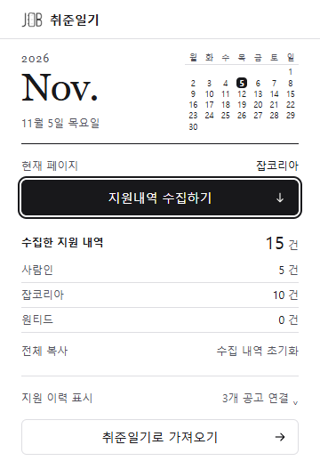

# 익스텐션 흑백 일기장 팝업

2026-11-05 · [이슈 #127](https://github.com/YouVin/jobdiary/issues/127). 사용자 승인 시안을 실제 Chrome 확장 팝업으로 옮긴 디자인·구현·검증 기록이다. 운영 main·스토어 출시는 별도다.

화면은 실제 개발 MV3 팝업 경로를 360×600 Chrome 탭에서 연 결과다. 수집 15건(사람인 5·잡코리아 10)과 비교 캐시 공고 3개는 개인정보 없는 별도 예시 데이터다. 두 숫자는 다른 저장소의 서로 다른 의미를 갖는다.

## 문제와 사용자 피드백

1. 자동 표시 기능을 추가하며 팝업 설명과 설정이 늘어 스크롤과 정보 밀도가 문제가 됐다. #123에서는 초기 세로 구성과 설정 접기를 복원했다.
2. 사용자는 UI/UX 개선과 함께 깔끔하고 직관적이며 세련된 화면을 요청했다. 미니멀·보라색 카드·종이색 시안 비교 후 서비스 이름인 ‘취준일기’의 일기 느낌을 더 살리기로 했다.
3. 크림 다이어리·라벤더 링 노트·세이지 플래너 중 크림 다이어리 구성을 선택했다. 이어 색은 화이트·블랙으로, 책갈피·장식은 줄이고 참고 사진처럼 월 이름과 작은 달력만 남기는 방향을 요청했다.
4. 최종 흑백 시안을 확인한 뒤 구현을 승인했다. 배지의 가시성 디자인은 이번 팝업 작업과 별도다.

## 최종 디자인 결정

- 흰 배경, 검정 핵심 버튼, 충분한 대비의 회색 보조 글자, 얇은 구분선을 쓴다. 종이 텍스처·링·장식 프레임·책갈피·추가 홍보 문구는 넣지 않는다.
- 월 이름만 시스템 serif(Georgia/Times New Roman)를 써 종이 일기의 분위기를 낸다. 본문·건수·버튼은 기존 시스템 sans-serif다. 외부 폰트나 이미지 요청을 추가하지 않는다.
- 상단 날짜 → 현재 사이트·수집 → 세로 건수 목록 → 복사·초기화 → 지원 이력 연결 정보 → 가져오기 순서다. 복사와 초기화는 텍스트 보조 버튼으로, 가져오기는 전체 너비 테두리 버튼으로 둔다.
- 수집한 내역은 확장 로컬 슬롯, 지원 이력 표시는 웹앱 기준 비교 캐시다. 숫자를 합치거나 ‘미지원’으로 해석하지 않는다.
- 상세 설정 또는 수집 안내가 나타나면 날짜 영역을 한 줄로 접고 작은 달력은 숨긴다. 월과 오늘 날짜는 유지한다. 기본 화면으로 돌아오면 달력도 다시 보인다.
- 복사 실패·초기화 재확인처럼 문구가 길어지면 도구 행을 줄바꿈한다. 최대 높이 600px와 세로 스크롤을 유지해 안내가 많아도 아래 동작에 접근할 수 있게 한다.

## 날짜와 달력의 의미

날짜는 지원일·수집일·마감일이나 일정 필터가 아니라 **팝업을 연 기기의 오늘 날짜**다. 브라우저의 현지 시간대를 사용하고 UTC 문자열 변환으로 날짜가 하루 어긋나지 않도록 한다. 한국 PC에서는 한국 날짜가 표시된다.

팝업이 새로 마운트될 때 한 번 계산하며, 계속 열어둔 채 자정이 지난 경우 닫았다 다시 열면 갱신된다. 별도 타이머·네트워크·저장소 키·권한·달력 라이브러리는 추가하지 않는다. 월요일 시작, 빈 앞뒤 칸을 포함한 최대 6주·42칸으로 윤년과 월 길이를 처리한다. 월 이동이나 날짜 선택 기능은 없다.

실제 table/caption/요일 헤더와 time dateTime을 사용한다. 오늘 한 칸에만 aria-current=date를 부여하고, 달력 칸에 버튼이나 탭 정지점을 만들지 않는다. 큰 날짜 표시는 12px로 유지하며 보조 달력만 9px다.

## 코드와 디자인 토큰

| 위치 | 책임 |
|---|---|
| apps/extension/src/popup/diaryCalendar.ts | 현지 날짜·월 길이·월요일 시작 주 배열 |
| apps/extension/src/popup/components/DiaryDate.tsx | 날짜와 접근성 있는 읽기 전용 달력 |
| apps/extension/src/popup/App.tsx | 기존 이벤트 처리를 유지한 화면 구성 |
| apps/extension/src/popup/components/Button.tsx | 핵심·보조·텍스트 버튼 변형 |
| apps/extension/src/popup/components/HistoryDisplayPanel.tsx | 접기 가능한 연결 상태·설정 |
| apps/extension/src/popup/index.css | 역할별 레이아웃·상태별 날짜 접기·포커스 |
| apps/extension/tailwind.config.ts | 확장 전용 diary 색·월 이름·달력 글자 토큰 |
| apps/extension/public/icons/ | 로컬 SVG 화살표, 장식 아이콘은 접근성 트리에서 제외 |

사용자가 승인한 흑백 방향은 익스텐션 전용 diary 토큰으로 관리한다. 웹앱의 보라색 브랜드 토큰과 사이트 내 지원 이력 배지에는 전파하지 않는다. 간격은 정수 Tailwind 단위, 색상은 토큰, SVG는 파일로 관리한다. 매니페스트·권한·수집 파서·메시지·저장 형식·웹앱 코드는 변경하지 않았다.

## 검증 결과

- 익스텐션 **211개 테스트 통과**. 기존 수집·복사·두 단계 초기화·가져오기와 상태 안내 회귀를 포함한다. 새 날짜 테스트는 11월의 일요일 시작과 월말, 윤년/평년 2월, 연말과 새해, 팝업 재오픈 시 날짜 전환, 오늘 한 칸과 의미 있는 time 속성을 확인했다.
- TypeScript 검사와 운영 빌드 통과. 별도 release/diary-validation/production 출력으로 활성 개발 dist를 보존했다.
- 실제 live 개발 확장으로 **Chromium 14개 시나리오 통과**. 흑백 색상·로고/화살표 로딩·오늘 한 칸·Tab 포커스·설정 스위치와 기존 배지 회귀를 확인했다.
- 실제 수집 메시지 → 표본 사이트 DOM 파서 → 로컬 슬롯 1건 저장 → 팝업 합계 6건 경로를 확인했다. 첫 초기화 클릭은 데이터를 유지하고, 재확인 후 수집 슬롯만 비우며 비교 캐시는 남았다. 이 경로는 사이트를 활성 상태로 둔 독립 팝업 탭에서 버튼 핸들러를 실행했다.
- 활성 개발 매니페스트의 content script 4개와 historyBadges 등록 1개를 확인했다. 개발 서버는 localhost:5173과 일치한다.

### 높이 실측

Windows·Chromium 151·360×600·기본 글자 크기, 페이지 내 실제 팝업 루트 측정이다. 안내가 없는 기본 상태에서 수집 15건/0건 모두 세 사이트 행을 유지한다.

| 상태 | 루트 높이 | 내부·문서 스크롤 |
|---|---:|---|
| 기본 연결 / 미식별 / 미연결 / 수집 0건 | 526.5px | 없음 |
| 설정 펼침 | 562px | 없음 |
| 미식별 35건·공고 주소 연결 안내까지 펼침 | 598px | 없음 |
| 1건 수집 성공과 마감일 안내, 날짜 한 줄 | 502px | 없음 |

초기 구현은 미식별 세부 안내가 추가될 때 600px를 넘었다. 달력 접기·도구와 사이트 행 간격 조정·설정 행 여백 축소로 내용은 유지하면서 위 높이로 정리했다. 공간이 부족하다고 오류나 안내를 잘라 숨기지 않는다.

### 재현 명령과 근거

루트에서 npm run test:extension, npm run build --workspace=jobdiary-extension -- --outDir ../../release/diary-validation/production을 실행했다.

브라우저 검증은 apps/extension/scripts/verify-history-badges-browser.mjs를 사용한다. 환경 변수 EXTENSION_PATH는 apps/extension/dist, DEV_SERVER_ORIGIN은 http://localhost:5173, BROWSER_EXECUTABLE은 설치된 Chrome 실행 경로로 지정한다. Vite 서버가 먼저 실행돼 있어야 한다.

자동 결과와 화면은 커밋 제외된 release/badge-validation/browser-report.json, popup-diary-default.png, popup-diary-collected.png에 남긴다. 이 문서의 이미지만 예시 화면으로 별도 보관한다.

## 확인하지 않은 범위

- 자동화는 독립 프로필의 실제 MV3와 팝업 HTML을 사용하며 사이트 HTTP는 예시 응답이다. 사용자의 로그인된 사이트 계정이나 OS의 실제 툴바 팝업 창을 조작한 결과로 표현하지 않는다.
- 확대 글꼴·OS 배율·다른 OS의 시스템 폰트, 여러 경고와 설정을 동시에 펼친 조합에서 스크롤이 전혀 없다고 보장하지 않는다. 긴 내용은 기존 세로 스크롤로 접근 가능하다.
- 지원 사실 비교와 사이트 배지 디자인·웹앱 UI·main 배포·스토어 제출은 이번 범위가 아니다. 운영 정책과 실계정 출시 확인은 기존 단계별 계획에 남긴다.
